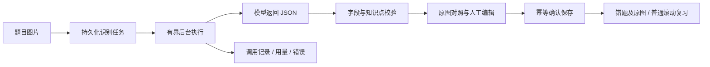

# AI 图片辅助录入与任务中心

F-011 / F-012，2026-10-11。实现位于 `codex/ai-image-intake` 功能分支。

## 已实现的流程

上传一张题目截图，后台调用支持图片的模型，生成题干、选项、LaTeX、图片中已有的答案和解析，并从现有知识树推荐知识点。用户对照原图编辑草稿，补充自己的错误答案和错误原因，确认后一起保存题目和原图，进入原有滚动复习流程。

模型不负责自动解题。图片未包含答案或解析时，对应草稿字段留空；保存前仍须补齐现有错题表单的必填项。识别不会自动创建错题、改变复习规则或创建知识点。



入口为侧栏「AI 辅助录入」「AI 任务中心」，以及手工录入页的 AI 入口。关闭页面不会停止已提交任务。任务中心提供状态筛选、分页、取消、人工重试、删除、调用明细、每日执行额度、已报告用量和成本估算。

## 模型配置

所有模型配置仅在后端环境变量中提供，修改后重启后端。浏览器不会读取密钥；仓库没有保存真实密钥。当前适配使用 JDK HTTP 客户端，协议为支持图片的兼容 Chat Completions 接口，没有引入模型 SDK。

默认 `AI_MODE=disabled`，此时普通录入和已有功能正常，AI 上传入口不可提交。

真实识别示例，在启动后端的同一个 PowerShell 会话设置：

```powershell
$env:AI_MODE = 'compatible'
$env:AI_BASE_URL = 'https://<模型服务域名>/v1'
$env:AI_MODEL = '<支持图片输入的模型 ID>'
$aiSecret = Read-Host '模型 API Key' -AsSecureString
$aiCredential = New-Object System.Net.NetworkCredential('', $aiSecret)
$env:AI_API_KEY = $aiCredential.Password
Remove-Variable aiCredential, aiSecret
$env:AI_DAILY_CALL_LIMIT = '20'
$env:AI_CONCURRENCY = '2'
$env:AI_TIMEOUT_SECONDS = '90'
# 同时按 README 提供 DB_PASSWORD 和图片目录，然后启动后端。
```

服务端会在 `AI_BASE_URL` 后追加 `/chat/completions`。不要把完整接口地址填入基础地址。模型服务须支持 `messages` 中的 `image_url` data URL、JSON 文本输出和 `max_tokens`。远程地址要求 HTTPS，不跟随重定向；仅 localhost / 127.0.0.1 / ::1 可用 HTTP。本轮使用本地 HTTP 夹具验证了协议，尚未配置真实服务商进行识别效果验收。

默认发送 `response_format: {"type":"json_object"}`；服务商不支持此字段时，可设置 `AI_RESPONSE_FORMAT=none`，服务端仍会严格解析及校验 JSON。成功返回必须包含：

```json
{
  "questionText": "计算 $1+1$ 的值。",
  "correctAnswer": "2",
  "analysis": "",
  "knowledgePointIds": [12],
  "warnings": []
}
```

`12` 仅是格式示例，推荐 ID 必须来自本次提供的知识点候选。草稿正文、答案、解析长度分别不超过 10000 / 5000 / 10000 字符；无题目、字段类型错误、截断及超大响应均失败。推荐项再按提交时快照和当前知识树校验，删除无效 ID 与跨科目推荐，并给出核对提示。

服务状态里的「启用」仅表示本地配置完整，不代表密钥有效、模型可访问或识别质量已验收。鉴权、限流等实际结果记录在任务和调用日志中。

## 无密钥演示

```powershell
$env:AI_MODE = 'demo'
$env:AI_MODEL = 'local-demo'
# 然后按现有启动说明启动后端和前端。
```

演示不需要密钥，不发送外部请求，返回明确标记的空白占位草稿。录入页、结果页和任务中心均注明「未识别图片内容」。用户仍可手动核对、填写并保存题目和原图，以展示完整工程流程。演示执行也计入本地每日执行额度；用量和成本显示未知，不伪造为零或真实账单。

切回真实模式需设置 `AI_MODE=compatible` 并重启后端。历史调用保留当时的模式和模型，人工重试使用重启后的当前模型配置。

## 可调参数

| 环境变量 | 默认值 | 含义 |
| --- | --- | --- |
| `AI_MODE` | disabled | disabled / demo / compatible |
| `AI_BASE_URL`、`AI_API_KEY` | 空 | 兼容服务基础地址和服务端密钥 |
| `AI_MODEL` | vision-model | 模型 ID，最多 100 字符 |
| `AI_TIMEOUT_SECONDS` | 90 | 整次 HTTP 请求含响应体的截止时间，1～300 秒 |
| `AI_CONCURRENCY` | 2 | 后台同时执行数，1～4 |
| `AI_MAX_ATTEMPTS` | 3 | 每轮总尝试次数，含首次，1～5 |
| `AI_MAX_MANUAL_RETRIES` | 2 | 每任务人工重新识别轮数，0～5 |
| `AI_DAILY_CALL_LIMIT` | 20 | 所有尝试的每日额度，1～10000 |
| `AI_MAX_KNOWLEDGE_POINTS` | 300 | 提交给模型的候选知识点数量上限，1～4096 |
| `AI_RESPONSE_FORMAT` | json_object | json_object / none |
| `AI_INPUT_PRICE_PER_MILLION` | 空 | 每百万输入 token 单价，非负 |
| `AI_OUTPUT_PRICE_PER_MILLION` | 空 | 每百万输出 token 单价，非负 |
| `AI_WORKER_ENABLED` | true | 生产后台开关；集成测试关闭后手动驱动 |

候选知识点超限时选择单科目缩小范围。并发、尝试数和额度均有上限；任务提交还有活动队列数量保护。当前为单用户、单后端实例，不能把同一个库交给多个后端实例运行。

每日日期使用现有业务时区 `APP_REVIEW_ZONE_ID`，默认 Asia/Shanghai。每次执行先在数据库原子预占额度；自动重试、失败、未知响应和演示执行都占一次。删除或取消不会返还额度。这里限制调用次数，不是服务商金额预算，也不是准确的服务商账单调用数。

只有服务商同时报告输入/输出 token，且两个单价都配置时才计算：

```text
估算成本 = (输入 token × 输入单价 + 输出 token × 输出单价) / 1000000
```

两种单价须使用相同币种。累计成本只包含仍保留且用量已知的记录。模型没有报告用量、连接中断、重启中断时，显示未知；部分已知费用不代表完整费用。

## 状态与故障恢复

| 状态 | 含义与可用操作 |
| --- | --- |
| QUEUED | 排队中，可取消 |
| RUNNING | 执行中，可取消；已发出的调用可能仍计费 |
| RETRY_WAIT | 等待有限自动重试，可取消 |
| SUCCEEDED | 有草稿，核对编辑后可确认保存 |
| FAILED | 查看错误；未超上限且有额度时可人工重试 |
| CANCELLED | 丢弃迟到结果；可在上限内重新识别 |
| APPLIED | 已保存，只能查看对应错题；已删除的题目不会被自动重建 |

网络失败、超时、429、服务商 5xx 可有限自动重试，默认等待 5 秒、10 秒。401/403、不可解析结果和额度用尽等不会自动重发。默认一轮最多 3 次，最多人工再启动 2 轮。每次重试仍可能产生服务商费用。

后端重启时把原 RUNNING 标为 FAILED，把对应调用标为 INTERRUPTED，不自动重发可能已计费的请求。QUEUED 和 RETRY_WAIT 仍可继续。超过请求超时加 60 秒仍在 RUNNING 的任务由定时恢复检查处理，避免一直挂起。

上传响应丢失后，浏览器保留原请求 UUID，提供「查找上次任务」，不会自动再次上传。人工重试携带当前重试轮数，过期重复请求返回 409。确认保存通过任务行锁和同一数据库事务保证同一草稿只创建一道题；原图复制复用现有文件事务补偿。保存响应丢失后锁住编辑，须同步服务器状态，确认已保存则进入错题详情；确认未保存才允许重新提交。

编辑后的草稿暂存在本浏览器 localStorage，刷新后恢复；确认入库后清除。换设备不会带上本地编辑内容，但服务端初始识别草稿仍在。不要在共享浏览器保存敏感草稿；清除站点数据会丢失尚未入库的本地编辑。

常见错误：

| 错误 | 处理 |
| --- | --- |
| AI_DISABLED / AI_CONFIGURATION_INVALID | 核对环境变量并重启后端 |
| AI_PROVIDER_AUTHENTICATION | 核对服务端密钥、账号和模型权限 |
| AI_PROVIDER_RATE_LIMIT / AI_PROVIDER_UNAVAILABLE | 等待有限重试；最终失败时检查服务商状态 |
| AI_PROVIDER_TIMEOUT / AI_PROVIDER_NETWORK | 检查网络，核对调用记录后决定是否人工重试 |
| AI_INVALID_OUTPUT / AI_NO_TEXT | 更换清晰、裁剪后的单题图片或手工录入 |
| AI_DAILY_LIMIT | 下一业务日期后人工重试，不自动跨日重发 |
| AI_PROCESS_INTERRUPTED / AI_TASK_STALLED | 核对可能已计费调用，再人工决定重试 |
| AI_IMAGE_STORAGE_ERROR | 检查图片目录权限、磁盘、原图与备份 |

## 图片、备份和清理

支持 PNG、JPEG、WebP、GIF，最大 20 MiB，服务端按内容签名识别，文件名只用于展示。输入保存于 `APP_QUESTION_IMAGE_DIRECTORY/ai-tasks/{uuid}.{extension}`，数据库中的 `image_path` 是该子目录内的相对键。确认保存后，题目拥有独立的 `questions/{questionId}/...` 图片副本。

现有备份脚本备份整张业务数据库和整个图片目录，因此同时包含三张 AI 表和 `ai-tasks`。备份和恢复应按现有停服流程协调完成。数据库密钥配置在环境中，不随数据库备份保存。

删除非活动任务会级联删除调用记录并清理输入图，已经保存的错题及其图片保留；活动任务须先取消。当前没有自动按日期删除任务。文件系统与 MySQL 无法形成物理原子事务；进程崩溃或清理失败可能留下孤儿文件，日志会提示清理失败。人工维护应先停服、备份，再仅删除 `ai_task.image_path` 不引用的输入文件，不能按任务 ID 推断文件名或删除整个图片目录。

## 春招演示与真实质量评测

建议演示：选择截图 → 查看后台任务与调用记录 → 对照原图修改识别草稿 → 补充个人错误原因 → 保存后检查题图、公式和复习状态。第二段演示失败重试、每日额度与保存响应丢失后的同步。

可据实讲解的工程点包括持久化任务状态机、有界执行、HTTP 全程截止时间、响应大小限制、JSON 校验、现有知识树约束、幂等提交/确认、并发额度预占、文件补偿和重启恢复。实现使用 JDBC 短事务调用既有 JPA 业务服务，模型 HTTP 请求在事务之外执行。没有使用消息中间件或分布式任务调度。

真实模型验收须另建带人工标准答案的样本集，覆盖清晰中文、选项、复杂公式、手写、模糊、图表、无答案、无解析、多题截图、提示注入和跨科目推荐。记录模型与配置、原图、期望转录、返回草稿、人工修正、耗时、token 和已知成本。比较题干转录、公式、答案缺失时是否留空、无效知识点比例与人工修改时间；不把 HTTP 夹具或演示占位草稿计为识别正确率。

2026-10-11 实际验证：后端 195 个测试通过，前端 21 个文件 / 140 个测试通过，类型检查和生产构建通过；独立数据库上的 Headless Microsoft Edge 验收通过上传、草稿刷新恢复、人工知识点选择、保存响应丢失后同步、仅创建一道题、题图复制、KaTeX、复习状态、任务只读、全局调用明细及删除任务保留题目。未配置真实模型密钥，尚未验证真实图片识别质量或服务商账单；正式数据库本轮未迁移，只读核对仍处于 V2，首次启动本分支后端时会顺序补齐 V3 / V4。
