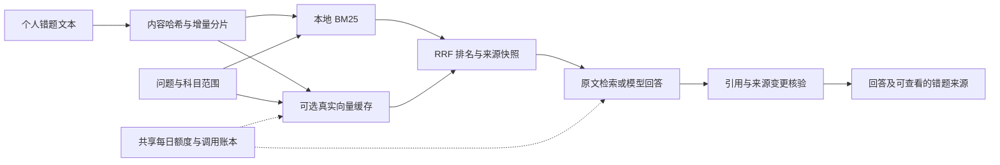

# ADR-005：有边界的个人错题库检索增强问答

- 日期：2026-10-13
- 状态：已采纳

## 问题

个人错题已经包含经人工核对的题干、答案、解析与错误原因。学习助手应能回答「以前哪些题也犯过这个错误」，并让每一项解释有可查看的题库依据。直接把整个题库发给模型会重复付费、超出上下文，也难以处理来源删除、取消与不确定响应。

## 决定

1. Flyway V5 增加会话、请求、索引片段和调用账本。正常错题仍通过现有 JPA 服务管理；助手用 JDBC 短事务维护任务，不在 HTTP 期间持有数据库事务。
2. 以题目文本和科目 / 知识点名字组装文档，SHA-256 检测变化。默认 900 字符片段、100 字符重叠；分片不拆开 Unicode 代理对。内容或切片配置变化时替换索引并清除旧向量，删除题目由外键级联清理。
3. 本地 BM25 使用中文双字词与拉丁词，k1=1.2、b=0.75。可选兼容 `/embeddings` 返回真实向量，拒绝维度不一致、非数值、零向量和超过 4096 维的结果。服务地址与模型指纹不同的缓存不参与检索。
4. 对当前范围所有有效片段做精确余弦扫描，BM25 与向量候选通过 RRF（k=60）融合，取默认 6 个片段、每题最多两个；固定错题入口优先提供该题片段。候选排序稳定。规模由题目 / 全库片段上限和并发配置明确约束。
5. 提示词只带当前问题与检索片段（可选同范围上一问题），不把历史模型回答用作证据。不开放工具调用、浏览或写题目能力。题库及用户输入都作为不可信数据，角色要求放系统提示中。
6. 回答须返回 JSON，引用编号仅可属于本次 S1～S8，并同时出现在正文与 citations 中。无引用、伪造编号、拒绝、截断或格式不正确时标记失败，保留来源与已报告用量。资料不足使用固定服务器提示。引用格式校验不能保证每个论断真实，真实模型仍须做事实验收。
7. 来源快照持久化并附原题 ID、内容哈希、片段、科目和知识点。历史查询标记原题已改 / 已删；生成完成时复查当前范围和内容，检测到变化则失败，保留这次模型调用已成功的记录。
8. 持久化队列由有界线程池领取（FOR UPDATE SKIP LOCKED）。单会话串行；共享图片功能的每日预占额度，每一次向量 / 回答 HTTP 均有账本。无自动付费重试；取消及人工重试通过状态和轮次隔离迟到结果。启动 / 超时恢复只标失败，适用于单实例。
9. 无真实模型时仅提供真实关键词检索，UI 标注为原文检索；不生成模拟语义向量或假回答。模型调用限制响应体 1 MiB、整体超时、禁止重定向，错误信息不包含原始响应或密钥。

## 取舍

选择 MySQL JSON 文本保存向量与内存扫描，避免为几千题的个人系统额外运行向量数据库。代价是查询仍与片段数量线性相关，每次加载并计算；不能据此声称支持大规模检索。

大题库第一次索引采用有限批次，覆盖不足时继续用关键词并展示提示，用户可分次补齐。全库片段上限限制总缓存，单次范围上限可以通过科目筛选缩小。

保存问答资料快照便于追溯；删除原题不会自动抹去历史会话中的快照，用户需另删除相关会话。模型只能读取相关资料，助手暂不自动生成练习、分析长期薄弱知识点或写回复习调度。

## 参考

- [Lucene BM25Similarity](https://lucene.apache.org/core/9_12_3/core/org/apache/lucene/search/similarities/BM25Similarity.html)
- [Elastic RRF 公式](https://www.elastic.co/docs/reference/elasticsearch/rest-apis/reciprocal-rank-fusion)
